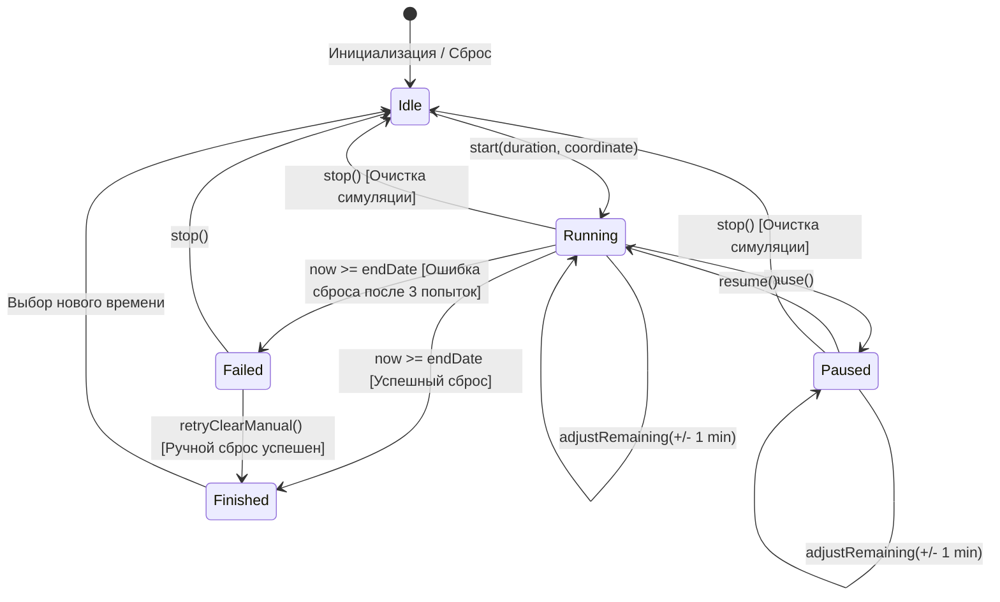
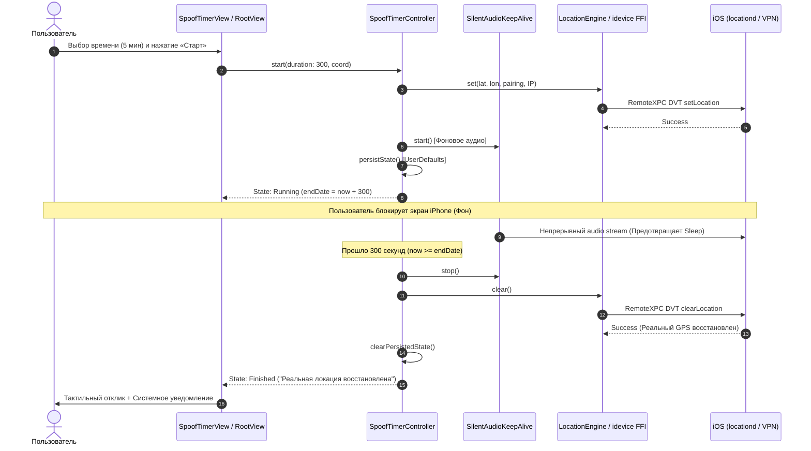

# Архитектура проекта Locus (Университетский отчёт)

## 1. Введение и назначение системы
Проект представляет собой клиентское iOS-приложение для управляемой симуляции системного местоположения (DVT Location Simulation) на устройствах Apple без необходимости джейлбрейка или модификации ядра операционной системы. 

В рамках данной работы базовый проект [ChrisMack32/Locus](https://github.com/ChrisMack32/Locus) был расширен механизмом **управляемого по времени спуфинга (Location Spoofing Timer)** с отказоустойчивым фоновым удержанием, сохранением персистентного состояния и автоматическим восстановлением истинных координат GPS.

---

## 2. Модульная структура

Система разделена на четыре ключевых слоя:

1. **Слой пользовательского интерфейса (Presentation Layer)**:
   - `RootView`: Корневой контейнер SwiftUI, агрегирующий карту, панель статуса и нижний блок управления.
   - `SpoofTimerView`: Панель таймера с отображением обратного отсчета (`mm:ss` / `hh:mm:ss`), круговым/линейным прогресс-баром, бейджем состояния и кнопками управления.
   - `CustomDurationPickerSheet`: Селектор кастомного времени (часы, минуты, секунды) в диапазоне от 5 секунд до 12 часов.
   - `ManualCoordinateSheet`: Форма ручного ввода и верификации координат широты и долготы с поддержкой распознавания из буфера обмена.
   - `MapHomeView`: Карта MapKit с интерактивными маркерами, поддержкой жестов перемещения булавки и поиском мест.

2. **Слой бизнес-логики и управления состоянием (Domain / Application Layer)**:
   - `SpoofTimerController`: Изолированный контроллер таймера (`ObservableObject`), реализующий детерминированную машину состояний.
   - `SpoofSession`: Главная сессия симуляции, координирующая взаимодействие с картой, джойстиком и списком избранных локаций.
   - `ReverseGeocoder`: Асинхронный сервис обратного геокодирования (`CLGeocoder`) для определения текстового адреса выбранной точки.

3. **Слой фонового удержания и оповещений (Infrastructure Layer)**:
   - `SilentAudioKeepAlive`: Фоновый аудиоплеер (`AVAudioPlayer`), воспроизводящий циклический беззвучный аудиопоток в категории `.playback` с флагом `.mixWithOthers`. Активируется исключительно на время работы таймера.
   - `TimerNotificationManager`: Менеджер системных локальных уведомлений (`UserNotifications`), планирующий алерт при наступлении дедлайна.
   - `BackgroundKeepAlive`: Легковесный клиент геолокации (`CLLocationManager`) для поддержания фоновой активности.

4. **Низкоуровневый системный слой (System / Hardware Abstraction Layer)**:
   - `LocationEngine`: Swift-модуль, транслирующий вызовы в C-библиотеку `idevice`.
   - `libidevice_ffi`: Статическая библиотека (Rust/C FFI), реализующая протоколы Apple RemoteXPC и DVT Location Simulation поверх сетевого туннеля.
   - `LocalDevVPN`: Внешний локальный туннель (Loopback VPN, `10.7.0.1`), предоставляющий доступ к интерфейсу симуляции Apple.

---

## 3. Машина состояний таймера (State Machine)

Контроллер `SpoofTimerController` управляется строгой машиной состояний:

### Семантика состояний:
* **Idle (Ожидание)**: Симуляция не привязана к таймеру; отображается базовое выбранное время.
* **Running (Активен)**: Таймер хранит абсолютную дату завершения `endDate: Date`. Тихий аудиотрек активен, локальное уведомление запланировано в системе.
* **Paused (На паузе)**: Обратный отсчет остановлен, но текущая симулированная локация сохраняется на устройстве. Аудиосессия отключена для экономии энергии.
* **Finished (Завершён)**: Время истекло, вызов `LocationEngine.clear()` прошел успешно, реальная геолокация восстановлена, сработал тактильный импульс (`UINotificationFeedbackGenerator`).
* **Failed (Ошибка)**: Сетевой туннель оборвался при попытке сброса, все 3 попытки завершились неудачей. Отображается предупреждающий баннер с кнопкой ручного повтора.

---

## 4. Диаграмма последовательности потоков данных (Data Flow)

Ниже представлена диаграмма жизненного цикла запуска таймера, работы в фоне и автоматического восстановления локации:

---

## 5. Механизмы надежности и персистентности

1. **Абсолютная временная метка (`Absolute End Date`)**:
   Контроллер не полагается на простой декрементный счетчик (`secondsRemaining -= 1`), который может задерживаться планировщиком iOS при высокой нагрузке на процессор. Вместо этого вычисляется точная дата `endDate = Date.now + duration`. При любом пробуждении приложения из фона остаток пересчитывается мгновенно:
   $$\text{remaining} = \max(0, \text{endDate} - \text{Date.now})$$

2. **Защита от сбоя при принудительном закрытии (Relaunch Recovery)**:
   При старте таймера его параметры (`endDate`, `totalDuration`, `coordinates`, `state`) сериализуются в `UserDefaults`. Если операционная система выгрузит приложение из памяти или пользователь закроет его свайпом, следующий запуск Locus в методе `checkPersistedStateOnLaunch()` прочитает эти данные:
   * Если время истекло — немедленно вызывается `LocationEngine.clear()`.
   * Если время еще есть — таймер корректно возобновляет работу с актуальным остатком.

3. **Экспоненциальная защита сброса (Retry on Clear Failure)**:
   Если в момент истечения таймера VPN-соединение кратковременно разорвалось, приложение не оставляет координаты зависшими, а выполняет серию повторных запросов (до 3 попыток с задержкой 1 секунда). Если все попытки исчерпаны, пользователь получает постоянный интерфейсный баннер с кнопкой повтора.

---

## 6. Аспекты тестирования и внедрения зависимостей (Dependency Injection)

Для обеспечения возможности покрытия модульными тестами без подключения физического iPhone и VPN-туннеля архитектура спроектирована с использованием интерфейсов (Swift Protocols):
* `ClockProtocol` — позволяет тестам эмулировать ход времени (`MockClock.advance(by:)`) без вызова реальных `Task.sleep`.
* `SimulationServiceProtocol` — позволяет симулировать успешные и аварийные сценарии FFI без наличия устройства.
* `AudioKeepAliveProtocol` — предотвращает запуск аудиосессий `AVAudioSession` во время выполнения юнит-тестов на раннерах CI.
